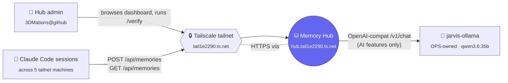
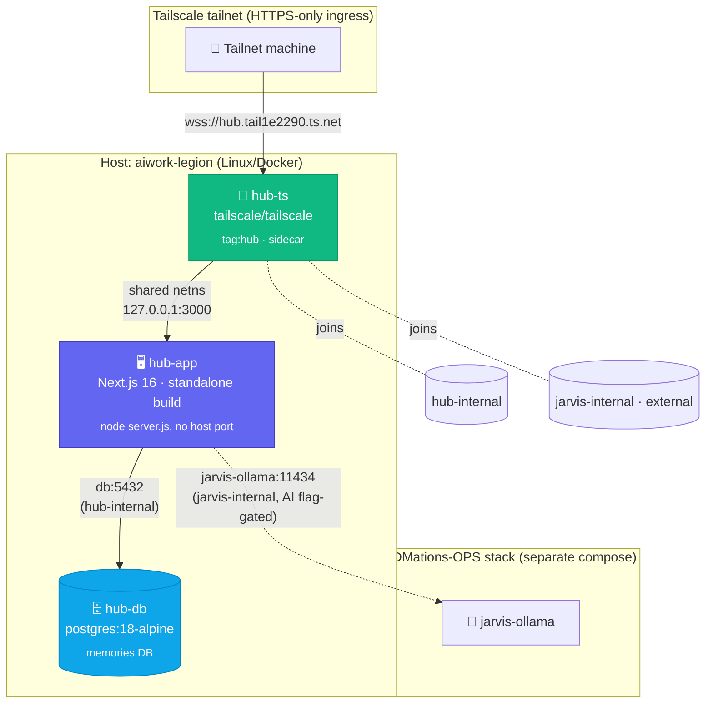
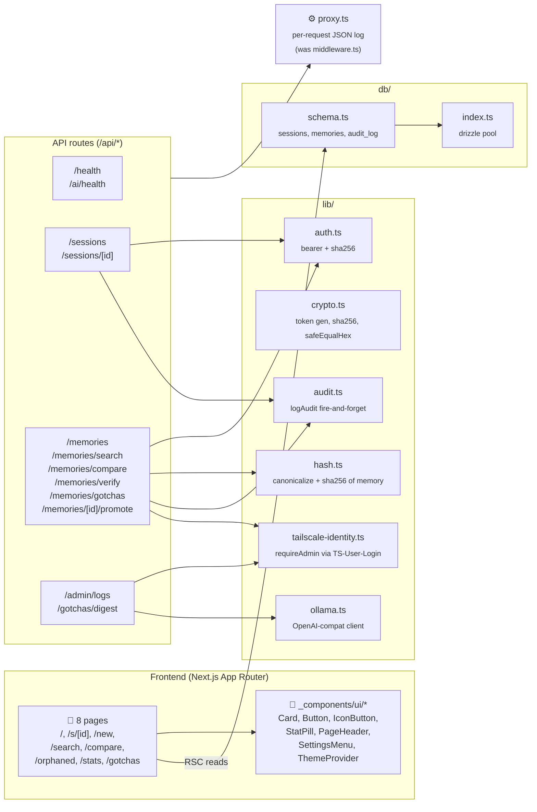

# APP_MAP — 3DMations Memory Hub

**Last updated:** 2026-04-26 (Phases 0–5 sealed; production build live on tailnet; full test suites green)
**Stack version:** v4.3
**Authority:** This file is the single source of truth for every wire/connection in the running hub. Update it at the seal of each phase. Per-phase seal records are preserved in chronological sections at the bottom — those are point-in-time and should not be edited retroactively.

## Test status (2026-04-26 audit)

| Suite | Count | Result |
|---|---|---|
| Vitest (unit + API contract, in-container) | 15 suites · 61 cases | **61/61 passing** |
| Playwright (browser E2E, against tailnet URL) | 7 cases | **7/7 passing** |
| Cucumber BDD (HTTP behavior, against tailnet URL) | 3 scenarios · 11 steps | **11/11 passing** |

---

## Purpose

The Hub is a single-user, multi-machine memory store for Claude Code sessions. It is reached locally over HTTP and (Phase 3+) over HTTPS / Tailscale by other machines on the user's tailnet. The frontend is a Next.js dashboard; the backend is the same Next.js process exposing `/api/*` route handlers; storage is a PostgreSQL 18 container; AI capabilities reuse the OPS-owned `jarvis-ollama` container over a shared Docker network.

---

## C4 Diagrams

Three layers, top-down. Mermaid syntax — renders inline on GitHub.

### Level 1 — System Context

Who uses the hub and what external systems it touches.



### Level 2 — Container

Deployable units inside the hub stack.



### Level 3 — Component (inside hub-app)

Major modules. Server components (RSC) read drizzle directly; route handlers under `/api/*` go through `lib/`.



---

## Current topology (as of 2026-04-26 — Phase 5 sealed)

The Phase 0 ASCII topology in git history is now superseded; here is the live wiring.

```
                              Tailscale tailnet
                              ─────────────────
   🤖 Claude Code session ─── HTTPS:443 ───▶ hub.tail1e2290.ts.net
   📱 Hub admin browser                                │
                                                       ▼
   ┌─── HOST: aiwork-legion ──────────────────────────────────────────────┐
   │                                                                      │
   │  ┌───────────────────────┐     network: hub-internal                 │
   │  │ hub-ts (sidecar)      │     network: jarvis-internal (external)   │
   │  │ tailscale/tailscale   │                                            │
   │  │ tag:hub               │     volume: hub-ts-state                  │
   │  │ Tailscale Serve       │      ─▶ /var/lib/tailscale                │
   │  │  443→127.0.0.1:3000   │                                            │
   │  └─────────┬─────────────┘                                            │
   │            │ network_mode: service:ts-hub                            │
   │            │ (shared netns)                                           │
   │            ▼                                                          │
│  ┌───────────────────────┐                                            │
  │  │ hub-app               │     (no mounts — multi-stage image,        │
  │  │ Next.js 16.2.4 PROD   │      standalone server baked in)           │
  │  │ (node server.js,      │     read_only rootfs · cap_drop ALL        │
  │  │  loopback bind)       │     no-new-privileges                      │
  │  │ React 19.2.4          │                                            │
  │  │ TS 5.9.3              │                                            │
  │  └────────┬──────────────┘                                            │
   │           │ DATABASE_URL                                              │
   │           ▼                                                            │
   │  ┌───────────────────────┐     volume: hub-db-data                   │
   │  │ hub-db                │      ─▶ /var/lib/postgresql               │
   │  │ postgres:18-alpine    │     (PG18 root — NOT /data)               │
   │  │ memories DB           │                                            │
   │  │ tables: sessions,     │                                            │
   │  │  memories, audit_log, │                                            │
   │  │  schema_version       │                                            │
   │  └───────────────────────┘                                            │
   │                                                                      │
   │     network: jarvis-internal (external — owned by 3DMations-OPS)    │
   │                       ┌──────────────────┐                           │
   │      AI_FEATURES_     │ jarvis-ollama    │                           │
   │      ENABLED-gated  ◄─┤ qwen3.6:35b      │  reused, not duplicated  │
   │                       │ port 11434       │                           │
   │                       └──────────────────┘                           │
   └──────────────────────────────────────────────────────────────────────┘

Debug profile (emergency local-only access — operator runs `stop app` first):
   browser → 127.0.0.1:${APP_PORT} → hub-app-debug (pnpm dev, HMR)
   docker compose --profile debug up -d app-debug
```

---

## Containers (live, post-Phase 5)

| Container  | Image                          | Owner   | Networks                          | Host port      | Internal | Purpose |
|------------|--------------------------------|---------|-----------------------------------|----------------|----------|---------|
| `hub-ts`   | `tailscale/tailscale:latest`   | hub     | `hub-internal`, `jarvis-internal` | (none — tailnet only) | 443/HTTPS | Tailscale Serve sidecar. Hostname `hub`, tag `tag:hub`. Terminates HTTPS, proxies to app via shared netns. |
| `hub-app`  | `3dmations-memory-app`         | hub     | (inherits via `network_mode: service:ts-hub`) | (none) | 3000 | Next.js 16 standalone server (`node server.js`, loopback bind). Frontend RSC + `/api/*` routes. Multi-stage image, non-root, read-only rootfs. |
| `hub-app-debug` (profile `debug`) | `3dmations-memory-app` | hub | `hub-internal` | `127.0.0.1:${APP_PORT}` | 3000 | Emergency loopback — runs `pnpm dev` with HMR. Mutually exclusive with `hub-app` (shared volumes). |
| `hub-db`   | `postgres:18-alpine`           | hub     | `hub-internal`                    | (none)         | 5432     | Memory store. PG18 with `pg_trgm`, `uuidv7()` native. |
| `jarvis-ollama` | `ollama/ollama`           | OPS     | `jarvis-internal`                 | `127.0.0.1:11434` | 11434 | LLM inference (qwen3.6:35b). Reused, not managed by this stack. |

`jarvis-ollama` is **not** managed by this project's `docker-compose.yml`; we attach to it by joining `jarvis-internal` as `external: true`. The hub never restarts it.

## Networks

| Network             | Driver | Scope     | Members                             | Purpose |
|---------------------|--------|-----------|-------------------------------------|---------|
| `hub-internal`      | bridge | this stack | `hub-app`, `hub-db`                 | App ↔ database, isolated from OPS |
| `jarvis-internal`   | bridge | external   | `hub-app`, `jarvis-ollama`, OPS svcs| Hub reaches Ollama by container name |

## Volumes

| Volume               | Mounted at                       | Owner    | Purpose |
|----------------------|----------------------------------|----------|---------|
| `hub-db-data`        | `hub-db:/var/lib/postgresql`     | hub      | Postgres data root (PG18 layout — NOT `/data`) |
| `hub-node-modules`   | `hub-app:/app/node_modules`      | hub      | Isolates host from Linux glibc deps; preserves install across recreates |
| `hub-next-cache`     | `hub-app:/app/.next`             | hub      | Production build output (incremental rebuilds) |
| `hub-ts-state`       | `hub-ts:/var/lib/tailscale`      | hub      | Tailscale node identity / cert state — preserves tagged-device registration across restarts |
| `./app` (bind)       | `hub-app:/app`                   | host     | Live source mount; production rebuild on container start |
| `./.claude/skills` (ro bind) | `hub-app:/.claude/skills`| host     | Read-only — exposes hub-scrubber skill to vitest tests inside container |
| `./tailscale/serve.json` (ro bind) | `hub-ts:/config/serve.json` | host | Version-controlled Tailscale Serve config |

## Persistent port allocation policy

| Port | Container  | Phase wired | Status   |
|------|------------|-------------|----------|
| 3000 | `hub-app`  | 0 → modified 3a | container-internal only since 3a (was loopback-bound). Tailnet is the only ingress. |
| 3000 | `hub-app-debug` | 3a       | host loopback `127.0.0.1:${APP_PORT}` ONLY when `--profile debug` active. |
| 443  | `hub-ts`   | 3a          | tailnet HTTPS (Tailscale-managed cert). No host binding — reachable only at `hub.tail1e2290.ts.net`. |
| 5432 | `hub-db`   | 0           | container-internal only — no host binding ever. |
| 8443 | (deprecated) | —         | Was reserved for `hub-tls` (Caddy/mTLS) in original v4.3 plan. Phase 3a obsoleted this — Tailscale-managed certs replace it. |

Forbidden — owned by other 3DMations stacks: 3001-3011, 3100, 4000, 4001, 5173, 8888, 11434.

---

## Workflow paths

### W1 — Browser request to landing page (Phase 0)
```
User browser
  → http GET 127.0.0.1:3000/
  → hub-app (Next.js dev server, Turbopack)
  → app/app/page.tsx (RSC, no data fetch)
  → HTML response (200)
```
No DB hit, no Ollama hit. This is the seal smoke test.

### W2 — Operator opens psql shell
```
User shell
  → make db
  → docker compose exec db psql -U hub -d memories
  → hub-db (UNIX socket inside container)
```
`hub-db` is not exposed to the host network; access requires entering the container.

### W3 — App boot (compose up)
```
docker compose up -d
  → starts hub-db (PG18 health: pg_isready every 5s, ≤10 retries)
  → starts hub-ts (Tailscale Serve sidecar, registers tag:hub via TS_AUTHKEY)
  → on db healthy + ts-hub started: starts hub-app
  → app runs `pnpm build && pnpm start` (production mode — no HMR socket)
  → reads .env (DATABASE_URL, OLLAMA_URL, AUTH_SECRET, AI_FEATURES_ENABLED, HUB_ADMIN_LOGIN)
```

### W4 — Claude session writes a memory (POST happy path)

```
Claude on remote machine (tailnet)
  → reads .claude/local/hub.env  → HUB_URL, HUB_SESSION, HUB_TOKEN
  → hub-scrubber skill scans payload  → throws ScrubberError on credential shape
  → POST https://hub.tail1e2290.ts.net/api/memories
       Authorization: Bearer <token>
       Content-Type: application/json
       body: { session_id, title, content, category, local_entry_id?, … }
  → Tailscale Serve injects Tailscale-User-Login (tagged-device callers don't get this)
  → app/proxy.ts emits {request_id, method, path, actor, duration_ms} JSON to stdout
  → app/api/memories/route.ts (POST handler)
       1. authenticate(): bearer.token_hash matches sessions.token_hash, token's session_id == body.session_id
       2. compute server-side content_hash = sha256(canonicalize({title, content, category}))
       3. INSERT (or UPSERT on local_entry_id) — UPSERT path increments recurrence + GREATEST(confidence)
       4. logAudit(memory.create | memory.upsert.update) → audit_log row
       5. respond 201 { row }
```

### W5 — Admin verifies content-hash drift

```
Admin browser (tailnet, logged in as HUB_ADMIN_LOGIN)
  → GET https://hub.tail1e2290.ts.net/api/memories/verify
  → Tailscale Serve injects Tailscale-User-Login
  → app/api/memories/verify/route.ts
       1. requireAdmin() compares header (case-insensitive) to HUB_ADMIN_LOGIN
       2. SELECT all memories
       3. for each: recompute hash, compare to stored content_hash
       4. respond { checked, ok, unhashed, drift[] } — 200 if drift=[], 409 otherwise
```

### W6 — Stats / Gotchas dashboard render (RSC)

```
Admin browser
  → GET https://hub.tail1e2290.ts.net/stats  (or /gotchas)
  → Tailscale Serve → hub-ts → 127.0.0.1:3000 (shared netns)
  → Next.js production server renders RSC
  → app/app/stats/page.tsx executes drizzle queries directly (bypassing /api/*)
       SELECT count(memories), count(sessions), count(NULL hashes)
       SELECT date_trunc('day', …) GROUP BY for 30-day sparkline
       SELECT t, COUNT(*) FROM memories, UNNEST(tags) GROUP BY t ORDER BY DESC LIMIT 10
       SELECT * FROM memories WHERE recurrence >= 2 ORDER BY recurrence DESC LIMIT 10
       SELECT recent sessions LIMIT 5
  → returns rendered HTML
```

### W7 — Ollama digest (Phase 5, AI flag-gated)

```
Admin browser or curl
  → POST https://hub.tail1e2290.ts.net/api/gotchas/digest?min=3
  → app/api/gotchas/digest/route.ts
       1. AI_FEATURES_ENABLED check — 503 if false
       2. requireAdmin(Tailscale-User-Login)
       3. SELECT memories WHERE recurrence >= 3 (with sessionName join)
       4. ollama.chat.completions.create({model, messages})
            → hub-ts netns → jarvis-internal → jarvis-ollama:11434
       5. respond { digest (markdown), gotcha_count, model }
```

### W8 — Debug profile (tailnet broken / dev iteration)

```
Operator on hub-host
  → docker compose stop app
  → docker compose --profile debug up -d app-debug
  → app-debug runs `pnpm dev` with HMR (no Tailscale Serve in path)
  → browser → http://127.0.0.1:${APP_PORT}
  → after debugging:
      docker compose --profile debug down app-debug
      docker compose up -d app   # back to production tailnet mode
```

---

## Environment variable flow

`.env` (project root, gitignored — `.env.example` is tracked as a template) is loaded by services via `env_file: .env`:

| Var                   | Consumer       | Phase | Used for |
|-----------------------|----------------|-------|----------|
| `POSTGRES_DB`         | hub-db, hub-app| 0     | db name `memories` |
| `POSTGRES_USER`       | hub-db, hub-app| 0     | db user `hub` |
| `POSTGRES_PASSWORD`   | hub-db, hub-app| 0     | db auth |
| `DATABASE_URL`        | hub-app        | 0     | `postgres://hub:<pw>@db:5432/memories` (composed at compose time) |
| `APP_PORT`            | compose        | 0     | host-side port for the **debug profile only** (production has no host port) |
| `AUTH_SECRET`         | hub-app        | 1     | session bearer-token signing + admin-token DELETE auth (Phase 1.6) |
| `OLLAMA_URL`          | hub-app        | 1.5   | `http://jarvis-ollama:11434` (reached over `jarvis-internal`) |
| `OLLAMA_MODEL`        | hub-app        | 1.5   | `qwen3.6:35b` |
| `AI_FEATURES_ENABLED` | hub-app        | 1.5/5 | Gates `/api/ai/health`, `/api/gotchas/digest`, `/api/memories/[id]/promote`. Default `false`. |
| `TS_AUTHKEY`          | hub-ts         | 3a    | Tailscale auth key (reusable + non-ephemeral + `tag:hub`). Used once per fresh container — state then persists in `hub-ts-state` volume. |
| `HUB_ADMIN_LOGIN`     | hub-app        | 3b    | Tailscale identity authorized for `/api/memories/verify`, `/api/admin/logs`, `/api/gotchas/digest`, `/api/memories/[id]/promote`. Compared case-insensitively. |

---

## Phase 0 frontend/backend snapshot — superseded

The Phase 0 sections (frontend showed only `/` placeholder; backend had zero `/api/*` routes; both `db:5432` and `jarvis-ollama:11434` were wired but unused) are preserved in git history at commit `3dc2882`. Today's complete frontend + API surface is in the **Frontend** and **API routes** tables above.

---

## Schema (live — all phases)

`pg_trgm 1.6` extension enabled. PG18 native `uuidv7()` available.

| Table            | Phase | Columns / notes |
|------------------|-------|-----------------|
| `sessions`       | 1     | `id` (12-char nanoid PK), `name`, `token_hash` (sha256 hex), `created_at`, `last_seen` |
| `memories`       | 1/3b  | `id` (uuid PK, `default uuidv7()`), `session_id` FK→sessions **ON DELETE SET NULL** (was CASCADE pre-1.6), `local_entry_id`, `title`, `content`, `category`, `tags TEXT[]`, `confidence REAL`, `recurrence INT`, `content_hash` (sha256 hex, server-computed), `metadata JSONB`, `created_at`, `updated_at` |
| `audit_log`      | 4     | `id` BIGSERIAL PK, `session_id` FK→sessions ON DELETE SET NULL, `action` (TEXT, e.g. `memory.create`), `entity_id` UUID nullable, `diff` JSONB, `request_id`, `actor` (Tailscale-User-Login at write time), `created_at` |
| `schema_version` | 1     | `version` (PK), `description`, `applied_at` — `(1, 'initial schema — PG18 with uuidv7')`. Manually-managed (not in `db/schema.ts`); reason `drizzle-kit push` requires `--force` to skip drop-prompt. |

**Indexes:**
- `memories_pkey` (uuid)
- `idx_memories_session_local_id` UNIQUE partial — `(session_id, local_entry_id) WHERE local_entry_id IS NOT NULL` (drives UPSERT ON CONFLICT)
- `idx_memories_title_trgm` / `idx_memories_content_trgm` GIN over `gin_trgm_ops`
- `idx_memories_tags` GIN over `(tags)`
- `idx_audit_session` btree `(session_id, created_at DESC)`
- `idx_audit_action` btree `(action, created_at DESC)`

Drizzle source: `app/db/schema.ts`. Schema changes are applied via direct SQL during seal (drizzle-kit push refuses without `--force` when `schema_version` is present, since drizzle-kit doesn't model that table). Extensions + GIN indexes are applied via `app/drizzle/post-push-init.sql`.

## API routes (live — all phases)

12 routes total. Auth column legend: `none` = open, `bearer` = session bearer token (`Authorization: Bearer …`), `admin-token` = `X-Admin-Token: $AUTH_SECRET` legacy, `ts-admin` = `Tailscale-User-Login` matches `HUB_ADMIN_LOGIN`.

| Method | Path                              | Auth        | Phase | Purpose |
|--------|-----------------------------------|-------------|-------|---------|
| GET    | `/api/health`                     | none        | 0     | DB ping + schema version |
| GET    | `/api/ai/health`                  | none        | 1.5   | Ollama reachability behind `AI_FEATURES_ENABLED` — 503 when off, 200 with model list when on |
| POST   | `/api/sessions`                   | none        | 1     | Create session, return `{id, token}` once + audit row |
| GET    | `/api/sessions`                   | none        | 1     | List sessions (no tokens, no hashes) |
| DELETE | `/api/sessions/[id]`              | admin-token | 1.6   | Default sets memories' `session_id=NULL`; `?with_memories=true` cascades. Audit row written. |
| POST   | `/api/memories`                   | bearer      | 1/3b/5| Create or UPSERT (on `local_entry_id`). Server computes `content_hash`. UPSERT increments `recurrence`, takes `GREATEST(confidence)`. Audit row distinguishes `memory.create` vs `memory.upsert.update`. |
| GET    | `/api/memories?q=&session=&limit=`| bearer      | 1     | List or trigram-rank by `q`; session filter optional |
| GET    | `/api/memories/search?q=&limit=`  | bearer      | 2     | Global trigram search across all sessions, with `sessionName` attribution |
| GET    | `/api/memories/compare?a=&b=&threshold=` | bearer | 2  | Three-bucket compare: `in_a_only`, `in_both` (similarity > threshold), `in_b_only` |
| GET    | `/api/memories/verify`            | ts-admin    | 3b    | Drift detector: recomputes every memory's `content_hash`, returns `{checked, ok, unhashed, drift[]}`. 200 if clean, 409 if drift, 401/500 on auth fail. |
| GET    | `/api/memories/gotchas?min=N`     | none        | 5     | Returns `{threshold, high_recurrence[], cross_session[]}`. Cross-session bucket finds title pairs across sessions with trigram similarity > 0.5. |
| POST   | `/api/memories/[id]/promote`      | ts-admin + AI flag | 5 | Asks Ollama to format a single memory as a Claude Code skill markdown stub. Returns text only — hub does NOT write to user filesystem. 503 when AI disabled. |
| GET    | `/api/admin/logs?limit=N`         | ts-admin    | 4     | Returns up to N recent `audit_log` rows (default 100, max 500). |
| POST   | `/api/gotchas/digest?min=N`       | ts-admin + AI flag | 5 | Ollama summarizes recurring memories into markdown digest. 503 when AI disabled. |

**Auth notes:**
- Bearer: SHA-256 `token_hash` compared with constant-time equality. Successful auth bumps `sessions.last_seen`. POST `/api/memories` also requires the token's session to equal `body.session_id` (403 otherwise).
- ts-admin: `Tailscale-User-Login` header is injected by Tailscale Serve and is spoof-safe (Serve strips inbound copies). Comparison against `HUB_ADMIN_LOGIN` is case-insensitive (since GitHub SSO casing differs from `.env` convention).
- Sensitive writes (POST, DELETE) emit an `audit_log` row via `app/lib/audit.ts`. Read endpoints don't.
- `app/proxy.ts` emits a structured JSON request log per `/api/*` request.

## Frontend (live — all phases)

8 pages. All RSC by default, with `force-dynamic` so they re-read DB on every request. Client interactivity comes from `_components/`.

| Route        | File                                        | Kind   | Data |
|--------------|---------------------------------------------|--------|------|
| `/`          | `app/app/page.tsx`                          | RSC    | Sessions list + memory counts; nav to Search/Compare/Stats/Gotchas/New; orphan link if any. |
| `/s/[id]`    | `app/app/s/[id]/page.tsx`                   | RSC    | Session detail; `?q=` switches to trigram ranking. |
| `/new`       | `app/app/new/page.tsx`                      | client | Form POSTs `/api/sessions`, displays bearer token once with copy button. |
| `/orphaned`  | `app/app/orphaned/page.tsx`                 | RSC    | Memories with `session_id IS NULL` (post keep-memories delete). |
| `/search`    | `app/app/search/page.tsx` + `SearchInput.tsx` | RSC + client input | Global trigram + ILIKE; result carries session badge or "orphaned" pill. Debounced. |
| `/compare`   | `app/app/compare/page.tsx`                  | RSC    | Two-session picker + threshold; renders `in_A_only` / `in_both` / `in_B_only`. |
| `/stats`     | `app/app/stats/page.tsx`                    | RSC    | KPIs (memories, sessions, unhashed legacy), 30-day bar sparkline, top tags, top recurrent, recent sessions. |
| `/gotchas`   | `app/app/gotchas/page.tsx`                  | RSC    | High-recurrence rows (≥3) + cross-session lookalikes (trigram > 0.5 across sessions). |

### Components (`app/app/_components/`)

| Path | Kind | Purpose |
|---|---|---|
| `SessionDeleteButton.tsx`     | client | Trash icon → 2-button modal (keep-memories vs cascade). Admin token cached in `sessionStorage`. |
| `ui/ThemeProvider.tsx`        | client | Pub/sub-based useTheme hook (no Context). Reads/writes localStorage `memory-hub:theme`. |
| `ui/SettingsMenu.tsx`         | client | Top-right gear icon → dropdown with light/dark toggle. |
| `ui/Card.tsx`, `Section.tsx`, `Button.tsx`, `IconButton.tsx`, `PageHeader.tsx`, `StatPill.tsx`, `EmptyState.tsx` | shared | Design-token-driven UI primitives. |

### Theme

`app/app/globals.css` defines CSS variables for both modes. `<html class="dark">` (default) or `class="light"`. Inline FOUC-prevention script in `<head>` reads localStorage before first paint.

Next.js 16 dynamic-route convention: `params` and `searchParams` are awaited Promises (used in `/s/[id]`, `/compare`, `/search`, `/gotchas`).

---

## Tests (all phases — green)

### Vitest (15 suites · 61 cases · in-container)

| Suite | Cases | Coverage |
|-------|-------|----------|
| `auth.test.ts`                | 2  | sha256 stability, `safeEqualHex` incl. malformed-hex rejection |
| `sessions.test.ts`            | 4  | POST 201, POST 400, GET list (no token leakage) |
| `sessions-delete.test.ts`     | 5  | DELETE 401 (no/wrong header), 404, 200 keep-memories (FK SET NULL), 200 cascade |
| `memories.test.ts`            | 7  | 401/403 paths, 201 + uuidv7, UPSERT idempotency, list, trigram-ranked |
| `orphaned.test.ts`            | 1  | After keep-memories delete, `/orphaned` SSR includes surviving titles |
| `search.test.ts`              | 3  | 401, 400 (empty q), 200 multi-session hits with `sessionName` attribution |
| `compare.test.ts`             | 3  | 401, three-bucket structure, threshold respected |
| `ollama.test.ts`              | 1  | `ollamaHealth()` reaches `jarvis-ollama` and lists `OLLAMA_MODEL` |
| `scrubber.test.ts`            | 18 | All 12 patterns, false-positive guards (git SHA, UUID, plain prose), multi-line PEM, payload helper |
| `memories-hash.test.ts`       | 3  | POST sets server-computed `content_hash`; client-supplied hash ignored; UPSERT recompute |
| `verify.test.ts`              | 4  | 401 missing header, 401 wrong login, 200 no drift, 409 drift induced via direct SQL UPDATE |
| `audit-log.test.ts`           | 3  | session.create row, memory.create row with `entity_id`, memory.upsert.update row distinct from create |
| `admin-logs.test.ts`          | 3  | 401 no header, 401 wrong login, 200 list with valid admin |
| `recurrence.test.ts`          | 2  | 3× UPSERT → recurrence=3; lower confidence does NOT replace (GREATEST) |
| `gotchas.test.ts`             | 2  | Endpoint shape `{threshold, high_recurrence, cross_session}`; entry hits high_recurrence after 3 replays |
| **total** | **61** | `docker compose exec -T app pnpm test` |

Run base URL defaults to `http://localhost:3000` inside the container; override with `HUB_BASE_URL`. Cleanup: `afterAll` deletes test sessions by name prefix.

### Playwright E2E (7 cases · against tailnet URL)

| File | Cases | Coverage |
|---|---|---|
| `e2e/dashboard.spec.ts` | 3 | Landing renders, `/orphaned` reachable, `/search` accepts input |
| `e2e/diagnose.spec.ts`  | 4 | Gear menu opens, `/stats` renders KPIs, `/gotchas` renders both sections, light/dark toggle persists across navigation |

Run: `PLAYWRIGHT_BASE_URL=https://hub.tail1e2290.ts.net pnpm test:e2e`

### Cucumber BDD (3 scenarios · 11 steps · against tailnet URL)

| Feature | Scenarios |
|---|---|
| `features/memories.feature` | Authenticated POST creates memory + 64-char content_hash; unauthenticated POST is rejected; client-supplied content_hash is ignored |

Run: `HUB_BASE_URL=… AUTH_SECRET=… pnpm test:bdd`

## Phase 1 seal — verified 2026-04-25

```
✓ PG 18.3 reported by SELECT version()
✓ uuidv7() native — sample 019dc20f-b561-7482-b7ca-013063794a27
✓ POST /api/sessions → 201 {id, token, ...}
✓ POST /api/memories with bearer → 201 with uuidv7 memory
✓ GET /api/memories?session=... → array
✓ vitest run → 13 passed (3 suites)
```

## Phase 1.5 — Ollama plumbing (sealed 2026-04-25)

`hub-app` reaches `jarvis-ollama` over the shared `jarvis-internal` Docker network. The wire was already verified during Phase 0; Phase 1.5 adds the typed client and a flag-gated health endpoint.

| File | Purpose |
|------|---------|
| `app/lib/ollama.ts` | OpenAI SDK pointed at `${OLLAMA_URL}/v1/` (`apiKey:"ollama"` placeholder, ignored by Ollama). `ollamaHealth()` queries Ollama's native `/api/tags` (model list — not exposed via `/v1`). |
| `app/app/api/ai/health/route.ts` | `GET` — returns 503 `{ok:false, reason:"AI features disabled"}` when `AI_FEATURES_ENABLED!=="true"`; otherwise returns 200 `{ok:true, model, available:[…]}` from `ollamaHealth()`. |
| `app/__tests__/ollama.test.ts` | Integration: confirms model list contains `OLLAMA_MODEL`. |

Feature flag default: **off** (`.env` ships with `AI_FEATURES_ENABLED=false`). Flip on only when a Phase 5+ feature needs it.

Flag-flip seal verified 2026-04-25:
```
✓ flag=false → /api/ai/health → 503 "AI features disabled"
✓ flag=true  → /api/ai/health → 200 {"model":"qwen3.6:35b","available":["qwen3.6:35b","qwen3:32b"]}
✓ flag flipped back to false; final 503; .env backups archived to .archive/env-snapshots/
✓ vitest run → 14 passed (4 suites)
```

## Phase 1.6 — Session management (sealed 2026-04-25)

`docs/plan-v4.3-phase-1.6.md` is the authoritative spec.

**Auth model chosen for DELETE:** admin-token, value = `AUTH_SECRET` from `.env`, sent as `X-Admin-Token`. Constant-time string compare (no Node `timingSafeEqual` because admin/provided lengths can differ). Admin token reuse vs `AUTH_SECRET` is a Phase 3 split candidate (TODO note in `app/app/api/sessions/[id]/route.ts`).

**FK predicate:** changed from `ON DELETE CASCADE` → `ON DELETE SET NULL`. Applied via direct ALTER (drizzle-kit push refused interactively in non-TTY context — recorded in commit message). Drizzle schema mirror updated.

**UX:** trash icon next to each session on `/`. Modal forces explicit choice — two buttons (keep-memories / cascade), no checkbox or default action. Admin token cached in `sessionStorage` per tab; cleared automatically on 401.

**Orphan view:** `/orphaned` lists `WHERE session_id IS NULL`. A small panel on `/` links to it when the orphan count is non-zero.

```
✓ ALTER TABLE memories FK → SET NULL
✓ DELETE /api/sessions/:id with X-Admin-Token guard
✓ Trash modal renders with two buttons; admin token sessionStorage cached
✓ /orphaned SSR'd 200 with NULL-session memory titles
✓ vitest run → 20 passed (6 suites)
```

## Phase 2 — Useful (sealed 2026-04-25)

**Endpoints + pages built:** `/api/memories/search`, `/api/memories/compare`, `/search`, `/compare`. Auth model on the new API routes is **bearer** (any valid session token), matching `/api/memories`. Dashboard pages bypass the API and read Drizzle directly — same SSR pattern as `/`, `/s/[id]`, `/orphaned`.

**Compare query design (per plan):**
- `in_both` — pairs `(a_id, b_id, sim)` joining `memories a, memories b WHERE similarity(a.title, b.title) > $threshold`. Returns up to 100 ranked pairs.
- `in_a_only` — A's memories with NO B-side match above threshold (NOT EXISTS subquery)
- `in_b_only` — symmetric
- Default threshold 0.4. Tunable via `?threshold=` (clamped to (0, 1)).

**Performance vs seal target (< 200ms for < 1000 memories):**
With 20 memories live across 2 sessions, SSR timings (warm):
```
/                                       44 ms
/search?q=docker                        27 ms
/search?q=trigram                       22 ms
/compare?a=…&b=…  (3 buckets, joins)    30 ms
```
GIN trigram indexes do the heavy lifting; large headroom against the seal.

**Wait-and-watch (1 week per plan):** is `compare` surfacing real insights or noise? Tune `threshold` if needed. Default 0.4 was the plan's; revisit empirically.

```
✓ /api/memories/search global hits across sessions, with sessionName join
✓ /api/memories/compare three buckets, threshold tunable, 401 / 400 / 404 correct
✓ /search debounced client input updates URL, RSC re-renders results
✓ /compare two pickers + threshold form, three columns rendered
✓ Performance: every route < 50ms; seal is < 200ms
✓ vitest run → 26 passed (8 suites)
```

## Phase 3 — Trusted (sealed 2026-04-25)

### 3a — Tailscale Serve sidecar (live)

**Topology change:** the app no longer publishes a host port. Tailnet (`https://hub.tail1e2290.ts.net`) is the only ingress. mTLS / `hub-tls:8443` from the original plan is **obsolete** — replaced by Tailscale-managed certs.

**New container:** `ts-hub` (image `tailscale/tailscale:latest`, hostname `hub`, joined to both `hub-internal` and `jarvis-internal`). The `app` service uses `network_mode: service:ts-hub` — shares the netns, sees `db:5432` and `jarvis-ollama:11434` through it.

**Debug profile** (`docker compose --profile debug up -d app-debug`): re-binds `127.0.0.1:${APP_PORT}:3000` for emergency local-only access. Mutually exclusive with `app` (shared volumes — operator runs `stop app` first).

**New files:** `tailscale/serve.json` (HTTPS:443 → :3000, `AllowFunnel: false`), `.env.example` (with `TS_AUTHKEY` + `HUB_ADMIN_LOGIN` placeholders), `docker-compose.yml.bak` (snapshot of pre-3a config).

**Pending user actions:** mint reusable+tagged Tailscale auth key, set `TS_AUTHKEY` and `HUB_ADMIN_LOGIN` in `.env`, run `docker compose up -d`.

### 3b — Scrubber + Integrity (live)

**Verified end-to-end:** `GET /api/memories/verify` returned `{checked: 28, ok: 2, unhashed: 26, drift: []}` after bring-up. The 26 unhashed are pre-3b legacy rows; new writes set content_hash server-side.

**Vitest:** 11 suites / 51 tests passing inside the container.

**Schema:** `memories.content_hash text` (column already in `db/schema.ts` from Phase 1; activated in 3b). Sync via `drizzle-kit push` at seal.

**API addition:** `GET /api/memories/verify` — admin-gated drift detector. Reads `Tailscale-User-Login` header, compares to `HUB_ADMIN_LOGIN`. Returns `{checked, ok, unhashed, drift}`; status 200 if clean, 409 if drift, 401 unauthorized, 500 if `HUB_ADMIN_LOGIN` unset.

**Server-side hashing:** `POST /api/memories` now computes `content_hash = sha256(canonicalize({title, content, category}))` itself; client-supplied `content_hash` is ignored. UPSERT path recomputes on update.

**New helpers:**
- `app/lib/hash.ts` — `canonicalize()`, `computeMemoryHash()`
- `app/lib/tailscale-identity.ts` — `requireAdmin(req)` reads `Tailscale-User-Login`, no loopback exception (O4=a)

**New skill:** `.claude/skills/hub-scrubber/` (12 patterns). Source-of-truth in this repo; per-machine install documented in `install.md`.

**New tests:** `__tests__/scrubber.test.ts` (12 patterns + false-positive guards + multi-line PEM + payload helper), `__tests__/memories-hash.test.ts` (server-side compute, client-hash ignored, UPSERT recompute), `__tests__/verify.test.ts` (auth gate + drift induction via direct SQL UPDATE).

## Phase 4 — Observable (sealed 2026-04-26)

**Schema:** `audit_log` table (BIGSERIAL pk, FK to sessions ON DELETE SET NULL, action, entity_id, diff JSONB, request_id, actor, created_at). Indexes on `(session_id, created_at DESC)` and `(action, created_at DESC)`. Applied via direct SQL — drizzle-kit push has the same `schema_version` drop blocker noted in Phase 3 §gotcha 3.

**Audit logging:** `app/lib/audit.ts` exposes `logAudit({action, sessionId, entityId, diff, requestId, actor})` — fire-and-forget, errors logged to console. Wired into POST /api/sessions, POST /api/memories (both create + UPSERT update), DELETE /api/sessions/[id]. Actor pulled from `Tailscale-User-Login` header.

**Structured request log:** `app/proxy.ts` (Next.js 16 renamed from `middleware.ts`). Emits single-line JSON to stdout for every `/api/*` request: `{ts, request_id, method, path, query, actor, duration_ms}`. Generates `x-request-id` if missing.

**Admin endpoint:** `GET /api/admin/logs?limit=N` (default 100, max 500). Tailscale-identity gated via `requireAdmin`. Returns `{count, limit, logs[]}`.

**Stats page:** `/stats` — KPIs (memories, sessions, unhashed legacy), 30-day sparkline, top 10 tags, top 10 most-recurrent memories, last 5 sessions.

## Phase 5 — Self-Improving (sealed 2026-04-26)

**UPSERT change:** POST /api/memories conflict path now does `recurrence = memories.recurrence + 1` and `confidence = GREATEST(memories.confidence, EXCLUDED.confidence)`. Repeated writes of the same `local_entry_id` accumulate recurrence; confidence is monotonic non-decreasing. Audit row distinguishes `memory.create` vs `memory.upsert.update`.

**Gotchas API + page:** `GET /api/memories/gotchas?min=N` returns `{threshold, high_recurrence[], cross_session[]}`. Cross-session bucket finds title pairs across sessions with trigram similarity > 0.5. `/gotchas` page renders both sections.

**AI features (gated on `AI_FEATURES_ENABLED=true`):**
- `POST /api/gotchas/digest` — Ollama summarizes recurring memories into a markdown digest. Admin-gated via Tailscale-identity. Returns 503 when AI features disabled.
- `POST /api/memories/[id]/promote` — Ollama formats a single memory into a Claude Code skill markdown stub (returned as text; hub does NOT write to user filesystem).

**Tests added:** audit-log (3), admin-logs (3), recurrence (2), gotchas (2). Total 61/61 vitest cases across 15 suites. Playwright diagnose.spec.ts covers gear menu + /stats + /gotchas + theme persistence (4/4 pass).

**Production-mode shift (was Phase 3 follow-up, sealed during UI Polish 2026-04-26):** Compose `app` service runs a prebuilt production server instead of `pnpm dev`. Tailscale Serve doesn't proxy WebSocket upgrades; Next.js dev-mode HMR socket failed in a loop and prevented React hydration site-wide. Debug profile keeps dev mode for HMR-friendly local-loopback iteration.

**Security hardening pass (2026-10-10 audit, P0–P2 sealed):**
- App binds `127.0.0.1:3000` inside the shared netns — NOT 0.0.0.0. With the
  old bind, any container on `jarvis-internal` could reach :3000 directly,
  bypass Tailscale Serve, and spoof `Tailscale-User-Login`. Loopback makes
  "tailnet is the only ingress" enforced, not assumed.
- `POST /api/sessions` is admin-gated (`X-Admin-Token` = AUTH_SECRET, same
  gate as session DELETE). Approvals: `make session name=…`, the `/new` page
  (asks for the admin token), or curl. Devices hold per-session bearer tokens.
- Per-service env allowlists (TS_AUTHKEY reaches only ts-hub, POSTGRES_*
  only db), digest-pinned images, non-root read-only containers with
  cap_drop ALL, healthchecks (app waits for db AND tailscaled healthy),
  nonce-based CSP + security headers, zod-validated bodies with length
  caps, statement_timeout 5s, rate limiting on mint/gotchas, indexed
  bearer-token lookup.
- Multi-stage Dockerfile (deps → build → runner on node:22-alpine digest);
  runtime image ships only the standalone server.

## Out of scope (Phase 6+, only build if triggered by usage)

Per plan: weekly digest scheduling, embedding-based dedup, multi-user RBAC,
Caddy fallback for non-tailnet access, mobile UI work. None planned.

This file MUST be updated at the seal of each phase.

---

## How to verify the map matches reality (2026-04-26)

```bash
# Containers
docker compose ps                        # hub-app + hub-db + hub-ts (Up)
docker network inspect jarvis-internal   # hub-ts listed as a member
docker network inspect 3dmations-memory_hub-internal

# Tailnet ingress (this host must also be on the tailnet)
tailscale status | grep hub              # 100.77.207.85 hub tagged-devices
curl -s https://hub.tail1e2290.ts.net/api/health
# {"status":"ok","db":"ok","schema_version":1}

# Schema
docker compose exec db psql -U hub -d memories -c "\dt"
# audit_log, memories, schema_version, sessions

# Routes (smoke from any tailnet machine)
curl -s https://hub.tail1e2290.ts.net/api/memories/verify | jq .
curl -s https://hub.tail1e2290.ts.net/api/memories/gotchas?min=3 | jq .ok
curl -s https://hub.tail1e2290.ts.net/api/admin/logs?limit=3 | jq '.logs | length'

# Ollama wire (jarvis-internal still works)
docker exec hub-app sh -c "wget -qO- http://jarvis-ollama:11434/api/tags | head -5"

# Tests
docker compose exec -T app pnpm test                                     # 61/61 vitest
PLAYWRIGHT_BASE_URL=https://hub.tail1e2290.ts.net pnpm -C app test:e2e   # 7/7 Playwright
HUB_BASE_URL=https://hub.tail1e2290.ts.net AUTH_SECRET=… \
  pnpm -C app test:bdd                                                    # 11/11 Cucumber
```
